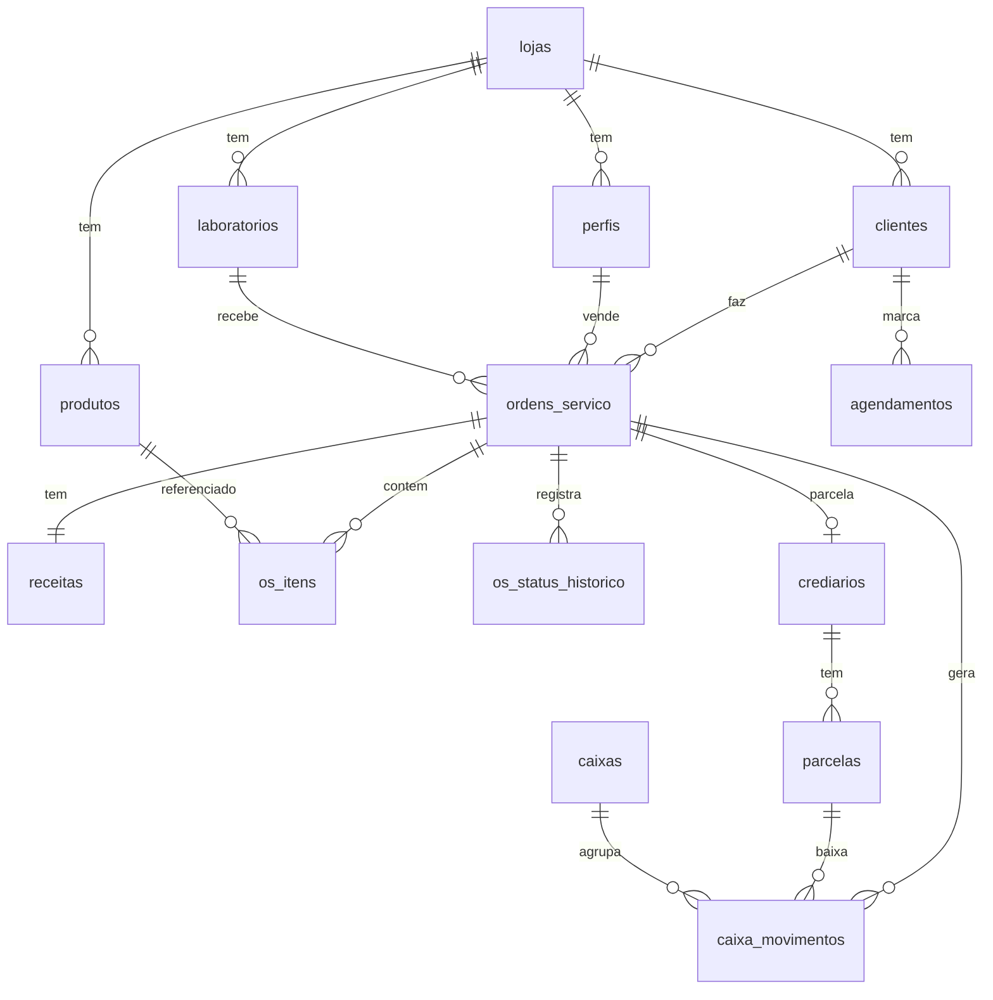

# Modelo de Dados

Projeto Supabase `gestao-otica` (ref `mhouxtzeomirluezzaql`, São Paulo).

| Migração | Conteúdo | Situação |
|---|---|---|
| `20261027000001_schema_inicial.sql` | Tabelas, gatilhos e RLS | Aplicada em 27/10/2026 |
| `20261027000002_permissoes_e_storage.sql` | `GRANT` da Data API e bucket `receitas` | Aplicada em 27/10/2026 |
| `20261027000003_gatilho_historico_e_crediario.sql` | Gatilho de histórico como dono; função `gerar_crediario` | Aplicada em 27/10/2026 |
| `20261028000004_email_no_perfil.sql` | `perfis.email` e `lojas.logo_icone_url` | Aplicada em 28/10/2026 |
| `20261031000005_catalogo_e_interessados.sql` | Foto e "no catálogo" em `produtos`; `catalogos`; `interessados_catalogo`; funções públicas `catalogo_publico` e `catalogo_registrar_interesse`; bucket público `catalogo` | Aplicada em 31/10/2026 (em 4 partes) |
| `20261031000006_provador.sql` | `produtos.provador_url`; `catalogo_publico` devolve código e imagem do provador | Aplicada em 31/10/2026 |
| `20261031000007_codigo_loja.sql` | `lojas.codigo` (1 = Ótica Nascimento, 2 = Studio Óptico Eucênia; próximas automáticas) | Aplicada em 31/10/2026 |

Edge Function `gerenciar-usuarios` (`supabase/functions/gerenciar-usuarios/index.ts`): cria usuários da loja, redefine senha e altera nome/papel/situação. Publicada com **Verify JWT desligado**; a função confere o token e o papel (admin ou gerente). Usa a chave secreta do ambiente (`SUPABASE_SECRET_KEYS`), nunca exposta ao front.

Depois das migrações: `supabase/setup/primeira-loja.sql` cria a primeira loja e liga o usuário a ela (feito em 27/10/2026: loja `Ótica Teste`, admin `ejnotica@gmail.com`). `supabase/setup/produtos-e-laboratorios-exemplo.sql` cadastra laboratórios e produtos para teste.

## Tabelas

| Tabela | Para que serve | Pontos de atenção |
|---|---|---|
| `lojas` | Multi-loja | Logo usada na impressão |
| `perfis` | Usuário ↔ loja + papel | Base do RLS (`minhas_lojas()`) e da comissão |
| `clientes` | Cadastro | `unique(loja_id, cpf_cnpj)`; campos fiscais para NF |
| `laboratorios` | Destino das lentes | `prazo_dias` sugere a previsão de entrega |
| `produtos` | Lentes, armações, serviços | `unidade_venda` define quantidade sugerida; atributos de lente |
| `ordens_servico` | OS | `numero` sequencial por loja via trigger |
| `os_status_historico` | Auditoria de status | Preenchida por trigger |
| `receitas` | 1:1 com OS | Longe, perto, DNP, altura, armação, imagem e flag de IA |
| `os_itens` | Itens da OS | `total` é coluna gerada |
| `caixas` / `caixa_movimentos` | Caixa | Entradas da OS e baixas de parcela |
| `crediarios` / `parcelas` | Crediário próprio | Parcelas geradas pelo domínio, gravadas em transação |
| `contas_pagar` | Fornecedores/labs | |
| `agendamentos` | Agenda | Cliente cadastrado ou nome avulso |
| `catalogos` | Catálogo da loja (1 por loja) | `slug` = endereço público `/catalogo/<slug>`; WhatsApp da loja; só admin/gerente altera |
| `interessados_catalogo` | Contatos vindos do catálogo | Inserção só pela função `catalogo_registrar_interesse` (sem login, com limite por número e por loja) |

## Segurança (RLS)
Todas as tabelas de negócio: `loja_id in (select minhas_lojas())` para leitura e escrita.
Papéis (`admin`, `gerente`, `vendedor`, `vendedor_externo`, `caixa`) refinam permissões nas próximas migrações (ex.: só `gerente` cancela OS finalizada).

## Storage
Bucket `receitas` (privado): `receitas/<loja_id>/<os_id>.<ext>`. Policy por `loja_id` no primeiro segmento do caminho.

## Próximas migrações previstas
- `estoque_movimentos` (entrada/saída por OS e compra)
- `comissoes`
- `notas_fiscais` (id do provedor, chave, status, XML/PDF)
- `mensagens_whatsapp` (fila de pós-venda)
